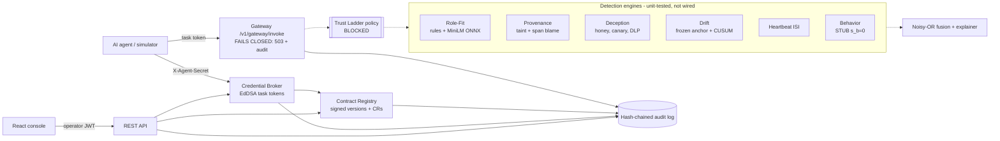

# Architecture (as built)

Solid boxes exist and are tested. Dashed boxes are designed in the PRD/TRD but missing from this build.

## Components
| Component | File | Notes |
|---|---|---|
| Config | `backend/app/config.py` | All TRD constants; env overrides |
| Persistence | `database.py`, `models.py` | SQLite WAL; `STATE_LOCK` serialises chain appends |
| Signing | `security/keys.py` | PyNaCl Ed25519; canonical JSON; verification against the *registered* key, not the key in the record |
| Operator auth | `security/auth.py` | Personas, roles, rate limits |
| Audit | `audit/chain.py` | `hash = sha256(canonical(event) ‖ prev_hash)`; verify, anchor |
| Contracts | `contracts/*` | Schema validation, compiler, signed registry, CR workflow, diff |
| Broker | `broker/tokens.py` | Mint, verify, revoke with cascade |
| Tools | `gateway/tools.py` | Synthetic VFS, MockSink, inert fixtures, redaction |
| Engines | `engines/*` | See the traceability matrix |
| Fusion | `fusion/*` | Noisy-OR plus deterministic templates |
| API | `api/routes.py`, `main.py` | Body-size limit, CORS |

## Request flow for a change request (implemented end to end)
1. The owner `POST /v1/change-requests` → change applied to a draft, validated, signed with the owner key → audit `change_request/submitted`.
2. Security `POST /v1/change-requests/{id}/approve` → requester ≠ approver, requester signature re-verified, base version still current → new version signed by owner + security → old version superseded → audit `change_request/approved`.
3. New task tokens bind to the new version; tokens for the old version are rejected with `stale_contract`.

## Async processing
Not implemented. There is no event bus (in-process or Redis) and no WebSocket stream. Health reports "in-process (Redis not configured)" only as the intended mode.

## Additional analysis and admin surfaces (implemented)
* `GET /v1/tokens`, `POST /v1/tokens/{jti}/revoke`: broker-backed listing and manual revocation, cascading to delegated tokens (security role, audited).
* `POST /v1/analyze`: Signal Lab. It runs the real engines on a hypothetical action. It is analysis only: no execution, no state change, no trust level (ADR-011).
* `GET /v1/reports/drift`: serves the measured drift benchmark (`reports/drift_eval.json`) to the Drift page.
